# Modelo entidad-relación

| Campo | Valor |
|---|---|
| Versión | 1.0 (cierre de la Fase 0) |
| Fecha | 23/10/2026 |
| Estado | Aprobado (23/10/2026) |
| Motor | PostgreSQL 17 (ver [ADR-003](decisions/ADR-003-base-de-datos.md)) |
| Versión DBML | [modelo-datos.dbml](modelo-datos.dbml) (se puede importar en dbdiagram.io) |

## 1. Descripción

El modelo representa la operación de varios talleres dentro de una sola base de datos ([ADR-006](decisions/ADR-006-multi-tenant.md)).

Cada **taller** tiene sus propios **usuarios**, **clientes**, **vehículos**, **órdenes de trabajo**, **catálogo de servicios** y **repuestos**. Estas son las *tablas raíz*, y todas llevan `taller_id`.

Una **orden de trabajo** se abre para un vehículo y guarda qué cliente era su dueño en ese momento. Así, si el vehículo cambia de dueño, el historial no se altera. La orden puede tener un **mecánico** asignado, que es un usuario con rol `MECANICO`. Además acumula:

- **historial de estados**: cada cambio de estado, con quién lo hizo y cuándo (de aquí salen los tiempos por etapa);
- **asignaciones**: cada asignación o reasignación de mecánico (P-7);
- **líneas de servicio**: mano de obra;
- **líneas de repuesto**: repuestos consumidos.

Cada **repuesto** tiene **movimientos de inventario** (entradas, salidas, ajustes y devoluciones). El stock actual siempre se puede explicar a partir de esos movimientos.

Hay tres conceptos que **no** tienen tabla propia:

| Concepto | Cómo se representa | Motivo |
|---|---|---|
| Técnico | Un `usuario` con `rol = MECANICO` | Evita duplicar nombre y credenciales |
| Factura o liquidación | Se calcula sumando cantidad × precio de las líneas de la orden (RN-06), sin IVA (P-9) | No se guarda un total que podría quedar desactualizado |
| Historial de mantenimiento | Una consulta de las órdenes del vehículo en estado `ENTREGADO` | Evita tener dos fuentes de verdad |

## 2. Tipos enumerados

| Tipo | Valores |
|---|---|
| `rol_usuario` | `ADMIN`, `RECEPCION`, `MECANICO` |
| `estado_orden` | `RECIBIDO`, `EN_DIAGNOSTICO`, `ESPERANDO_REPUESTOS`, `REPARADO`, `ENTREGADO`, `CANCELADA` |
| `tipo_movimiento` | `ENTRADA`, `SALIDA`, `AJUSTE`, `DEVOLUCION` |

## 3. Entidades y atributos

Convenciones de esta sección:

- **PK** = llave primaria · **FK** = llave foránea · **UQ** = valor único.
- Todas las `id` son `bigint` con identidad generada por la base de datos.
- Las fechas con hora usan `timestamptz` (con zona horaria).
- El dinero usa `numeric(12,2)` en pesos colombianos.
- Las cantidades usan `numeric(10,2)`.

### 3.1 `taller`

| Atributo | Tipo | Nulo | Llave / restricción |
|---|---|---|---|
| id | bigint | no | **PK** |
| nombre | varchar(120) | no | |
| nit | varchar(20) | sí | Los talleres informales no tienen NIT |
| es_formal | boolean | no | por defecto `false` |
| telefono | varchar(20) | sí | |
| direccion | varchar(200) | sí | |
| siguiente_numero_orden | integer | no | por defecto 1; CHECK ≥ 1. Consecutivo de órdenes del taller (RN-12) |
| activo | boolean | no | por defecto `true` |
| creado_en | timestamptz | no | por defecto `now()` |

### 3.2 `usuario`

| Atributo | Tipo | Nulo | Llave / restricción |
|---|---|---|---|
| id | bigint | no | **PK** |
| taller_id | bigint | no | **FK** → taller.id |
| nombre | varchar(120) | no | |
| email | varchar(254) | no | **UQ en todo el sistema**; se guarda en minúsculas |
| password_hash | varchar(255) | no | hash argon2id |
| rol | rol_usuario | no | |
| activo | boolean | no | por defecto `true` |
| ultimo_acceso | timestamptz | sí | |
| creado_en | timestamptz | no | por defecto `now()` |

### 3.3 `cliente`

| Atributo | Tipo | Nulo | Llave / restricción |
|---|---|---|---|
| id | bigint | no | **PK** |
| taller_id | bigint | no | **FK** → taller.id |
| nombre | varchar(120) | no | |
| telefono | varchar(20) | no | |
| email | varchar(254) | sí | |
| documento | varchar(20) | sí | **UQ parcial** `(taller_id, documento)` cuando el documento no es nulo |
| autoriza_datos | boolean | no | CHECK `autoriza_datos = true` (RN-10) |
| fecha_autorizacion | timestamptz | no | |
| anonimizado | boolean | no | por defecto `false` (RN-11) |
| anonimizado_en | timestamptz | sí | cuándo se anonimizó (A-7) |
| anonimizado_por | bigint | sí | **FK** → usuario.id; quién lo anonimizó, siempre un ADMIN (A-7) |
| activo | boolean | no | por defecto `true` |
| creado_en | timestamptz | no | por defecto `now()` |
| actualizado_en | timestamptz | no | por defecto `now()` |

### 3.4 `vehiculo`

| Atributo | Tipo | Nulo | Llave / restricción |
|---|---|---|---|
| id | bigint | no | **PK** |
| taller_id | bigint | no | **FK** → taller.id |
| cliente_id | bigint | no | **FK** → cliente.id (dueño actual) |
| placa | varchar(10) | no | **UQ** `(taller_id, placa)`; normalizada (RN-20) |
| marca | varchar(50) | no | |
| modelo | varchar(50) | no | |
| anio | smallint | sí | CHECK entre 1950 y 2100 |
| color | varchar(30) | sí | |
| activo | boolean | no | por defecto `true` |
| creado_en | timestamptz | no | por defecto `now()` |

### 3.5 `orden_trabajo`

| Atributo | Tipo | Nulo | Llave / restricción |
|---|---|---|---|
| id | bigint | no | **PK** |
| taller_id | bigint | no | **FK** → taller.id |
| numero | integer | no | **UQ** `(taller_id, numero)` (RN-12) |
| vehiculo_id | bigint | no | **FK** → vehiculo.id |
| cliente_id | bigint | no | **FK** → cliente.id (dueño en el momento de la orden) |
| mecanico_id | bigint | sí | **FK** → usuario.id; el usuario debe tener rol `MECANICO` (se valida en el servicio) |
| creado_por | bigint | no | **FK** → usuario.id |
| codigo_seguimiento | varchar(32) | no | **UQ en todo el sistema**; al menos 128 bits aleatorios (ADR-005) |
| estado | estado_orden | no | por defecto `RECIBIDO` |
| kilometraje | integer | sí | CHECK ≥ 0 |
| motivo_ingreso | text | no | |
| diagnostico | text | sí | |
| trabajo_realizado | text | sí | obligatorio para pasar a `REPARADO` (RN-17) |
| motivo_cancelacion | text | sí | CHECK: no nulo si `estado = CANCELADA` (RN-18) |
| fecha_ingreso | timestamptz | no | por defecto `now()` |
| fecha_entrega_estimada | date | sí | |
| fecha_entrega | timestamptz | sí | CHECK: no nula si `estado = ENTREGADO` |
| actualizado_en | timestamptz | no | por defecto `now()` |

Índices adicionales:

- **UQ parcial** `(vehiculo_id)` donde `estado NOT IN ('ENTREGADO','CANCELADA')`: un vehículo solo puede tener una orden abierta (RN-08).
- Índices `(taller_id, estado)` y `(taller_id, fecha_ingreso)` para el dashboard y los reportes.

### 3.6 `historial_estado_orden`

Solo admite inserciones; los registros nunca se modifican ni se borran (RN-01, RN-11).

| Atributo | Tipo | Nulo | Llave / restricción |
|---|---|---|---|
| id | bigint | no | **PK** |
| orden_id | bigint | no | **FK** → orden_trabajo.id |
| estado_anterior | estado_orden | sí | nulo solo en el registro de creación |
| estado_nuevo | estado_orden | no | CHECK: distinto de `estado_anterior` |
| usuario_id | bigint | no | **FK** → usuario.id |
| fecha | timestamptz | no | por defecto `now()` |
| nota | text | sí | obligatoria al retroceder de estado (se valida en el servicio) |

Índice: `(orden_id, fecha)`.

### 3.7 `asignacion_orden`

Solo admite inserciones (RN-14, P-7).

| Atributo | Tipo | Nulo | Llave / restricción |
|---|---|---|---|
| id | bigint | no | **PK** |
| orden_id | bigint | no | **FK** → orden_trabajo.id |
| mecanico_id | bigint | no | **FK** → usuario.id |
| asignado_por | bigint | no | **FK** → usuario.id |
| fecha | timestamptz | no | por defecto `now()` |
| nota | text | sí | |

### 3.8 `servicio` (catálogo de mano de obra)

| Atributo | Tipo | Nulo | Llave / restricción |
|---|---|---|---|
| id | bigint | no | **PK** |
| taller_id | bigint | no | **FK** → taller.id |
| nombre | varchar(120) | no | **UQ** `(taller_id, nombre)` |
| precio_referencia | numeric(12,2) | no | CHECK ≥ 0 |
| activo | boolean | no | por defecto `true` |

### 3.9 `orden_servicio`

| Atributo | Tipo | Nulo | Llave / restricción |
|---|---|---|---|
| id | bigint | no | **PK** |
| orden_id | bigint | no | **FK** → orden_trabajo.id |
| servicio_id | bigint | sí | **FK** → servicio.id; nulo si la línea se escribió como texto libre |
| descripcion | varchar(200) | no | se copia del catálogo o se escribe a mano |
| cantidad | numeric(10,2) | no | CHECK > 0 |
| precio_unitario | numeric(12,2) | no | CHECK ≥ 0; es una copia del precio en ese momento (RN-05) |
| registrado_por | bigint | no | **FK** → usuario.id (RN-15) |
| creado_en | timestamptz | no | por defecto `now()` |

### 3.10 `repuesto`

| Atributo | Tipo | Nulo | Llave / restricción |
|---|---|---|---|
| id | bigint | no | **PK** |
| taller_id | bigint | no | **FK** → taller.id |
| codigo | varchar(30) | no | **UQ** `(taller_id, codigo)` |
| nombre | varchar(120) | no | |
| unidad | varchar(20) | no | por defecto `'unidad'` (por ejemplo: litro, juego) |
| precio_venta | numeric(12,2) | no | CHECK ≥ 0 |
| stock_actual | numeric(10,2) | no | por defecto 0; **CHECK ≥ 0** (RN-02) |
| stock_minimo | numeric(10,2) | no | por defecto 0; CHECK ≥ 0 |
| activo | boolean | no | por defecto `true` |
| creado_en | timestamptz | no | por defecto `now()` |
| actualizado_en | timestamptz | no | por defecto `now()` |

### 3.11 `orden_repuesto`

| Atributo | Tipo | Nulo | Llave / restricción |
|---|---|---|---|
| id | bigint | no | **PK** |
| orden_id | bigint | no | **FK** → orden_trabajo.id |
| repuesto_id | bigint | no | **FK** → repuesto.id |
| cantidad | numeric(10,2) | no | CHECK > 0 |
| precio_unitario | numeric(12,2) | no | CHECK ≥ 0; es una copia del precio en ese momento (RN-05) |
| registrado_por | bigint | no | **FK** → usuario.id (RN-15) |
| creado_en | timestamptz | no | por defecto `now()` |

Si se quita un repuesto de la orden, la línea se borra. Esto solo se permite mientras la orden está abierta (RN-07). La trazabilidad no se pierde, porque se registra un movimiento `DEVOLUCION` (RN-03).

### 3.12 `movimiento_inventario`

Solo admite inserciones (RN-11).

| Atributo | Tipo | Nulo | Llave / restricción |
|---|---|---|---|
| id | bigint | no | **PK** |
| repuesto_id | bigint | no | **FK** → repuesto.id |
| orden_id | bigint | sí | **FK** → orden_trabajo.id; obligatorio si el tipo es `SALIDA` o `DEVOLUCION` |
| usuario_id | bigint | no | **FK** → usuario.id |
| tipo | tipo_movimiento | no | |
| cantidad | numeric(10,2) | no | con signo: positiva para `ENTRADA` y `DEVOLUCION`, negativa para `SALIDA`, distinta de 0 para `AJUSTE` |
| stock_resultante | numeric(10,2) | no | CHECK ≥ 0; el stock que quedó después del movimiento |
| fecha | timestamptz | no | por defecto `now()` |
| nota | text | sí | obligatoria en `AJUSTE` (se valida en el servicio) |

CHECK compuesto:

- `(tipo IN ('ENTRADA','DEVOLUCION') AND cantidad > 0)`
- `OR (tipo = 'SALIDA' AND cantidad < 0)`
- `OR (tipo = 'AJUSTE' AND cantidad <> 0)`
- y además `(tipo NOT IN ('SALIDA','DEVOLUCION') OR orden_id IS NOT NULL)`.

Índice: `(repuesto_id, fecha)`.

## 4. Relaciones y cardinalidades

| Relación | Cardinalidad | Obligatoriedad | Descripción |
|---|---|---|---|
| taller – usuario | 1 : N | todo usuario pertenece a un taller | El taller emplea usuarios |
| taller – cliente | 1 : N | obligatoria | El taller atiende clientes |
| taller – vehiculo | 1 : N | obligatoria | El taller registra vehículos |
| taller – orden_trabajo | 1 : N | obligatoria | El taller gestiona órdenes |
| taller – servicio | 1 : N | obligatoria | El taller ofrece servicios |
| taller – repuesto | 1 : N | obligatoria | El taller almacena repuestos |
| cliente – vehiculo | 1 : N | todo vehículo tiene un dueño actual | El cliente posee vehículos |
| vehiculo – orden_trabajo | 1 : N (como máximo 1 abierta) | toda orden tiene un vehículo | El vehículo recibe órdenes |
| cliente – orden_trabajo | 1 : N | toda orden tiene un cliente | Dueño en el momento de la orden |
| usuario (mecánico) – orden_trabajo | 0..1 : N | la orden puede no tener mecánico al crearse | Mecánico asignado actualmente |
| usuario – orden_trabajo (creado_por) | 1 : N | obligatoria | Quién abrió la orden |
| orden_trabajo – historial_estado_orden | 1 : 1..N | toda orden tiene al menos el registro de creación | Cambios de estado |
| orden_trabajo – asignacion_orden | 1 : 0..N | opcional | Historial de asignaciones |
| orden_trabajo – orden_servicio | 1 : 0..N | opcional | Mano de obra |
| servicio – orden_servicio | 0..1 : N | la línea puede ser texto libre | Referencia al catálogo |
| orden_trabajo – orden_repuesto | 1 : 0..N | opcional | Repuestos consumidos |
| repuesto – orden_repuesto | 1 : N | obligatoria | Qué repuesto se usó |
| repuesto – movimiento_inventario | 1 : 0..N | opcional | Trazabilidad del stock |
| orden_trabajo – movimiento_inventario | 0..1 : N | obligatoria en `SALIDA` y `DEVOLUCION` | Qué orden originó el movimiento |
| usuario – historial, asignación, líneas y movimientos | 1 : N | obligatoria | Trazabilidad por usuario (P-7) |
| usuario – cliente (anonimizado_por) | 0..1 : N | solo en clientes anonimizados | Quién anonimizó al cliente (RN-11, A-7) |

**Relación muchos a muchos resuelta.** Orden y repuesto tienen una relación N:M, que se resuelve con `orden_repuesto` (lleva cantidad y precio). Lo mismo ocurre entre orden y servicio, que se resuelve con `orden_servicio`.

## 5. Restricciones y reglas que garantiza la base de datos

| Regla | Mecanismo |
|---|---|
| El stock nunca es negativo (RN-02) | `CHECK repuesto.stock_actual >= 0` + `SELECT … FOR UPDATE` en el servicio |
| Placa única por taller | UQ `(taller_id, placa)` |
| Una sola orden abierta por vehículo (RN-08) | Índice único parcial |
| Consecutivo de orden por taller (RN-12) | `taller.siguiente_numero_orden` con bloqueo de fila + UQ `(taller_id, numero)` |
| Enlace de seguimiento único | UQ `codigo_seguimiento` |
| Autorización de datos obligatoria (RN-10) | `CHECK cliente.autoriza_datos = true` |
| Anonimización coherente y auditada (RN-11, A-7) | `CHECK` `ck_cliente_anonimizacion_coherente`: sin anonimizar no hay auditoría; anonimizado exige `anonimizado_en` y `anonimizado_por`, sin correo ni documento, e inactivo |
| Motivo obligatorio al cancelar (RN-18) | `CHECK (estado <> 'CANCELADA' OR motivo_cancelacion IS NOT NULL)` |
| Fecha de entrega obligatoria al entregar | `CHECK (estado <> 'ENTREGADO' OR fecha_entrega IS NOT NULL)` |
| Cantidades y precios válidos | CHECK `> 0` en cantidades y `>= 0` en precios |
| Signo coherente de los movimientos | CHECK compuesto de `movimiento_inventario` |
| No se borra la historia (RN-11) | Las FK usan `ON DELETE RESTRICT`; el código nunca ejecuta `DELETE` sobre esas tablas |

**Reglas que garantiza la capa de servicios** (las cubren pruebas obligatorias):

- transiciones de estado (SPEC §7);
- pertenencia de cada referencia al mismo taller (ADR-006);
- el mecánico asignado debe tener rol `MECANICO` (RN-16);
- `trabajo_realizado` es obligatorio para pasar a `REPARADO` (RN-17);
- la nota es obligatoria al retroceder de estado y en los ajustes de inventario;
- cálculo de la liquidación (RN-06);
- anonimización del cliente (RN-11): solo ADMIN, confirmación escrita, sin órdenes abiertas e irreversible (SPEC §21.7).

## 6. Diagrama ER (Mermaid)

```mermaid
erDiagram
    TALLER ||--o{ USUARIO : emplea
    TALLER ||--o{ CLIENTE : atiende
    TALLER ||--o{ VEHICULO : registra
    TALLER ||--o{ ORDEN_TRABAJO : gestiona
    TALLER ||--o{ SERVICIO : ofrece
    TALLER ||--o{ REPUESTO : almacena
    CLIENTE ||--o{ VEHICULO : posee
    CLIENTE ||--o{ ORDEN_TRABAJO : "duenio al momento"
    VEHICULO ||--o{ ORDEN_TRABAJO : recibe
    USUARIO |o--o{ ORDEN_TRABAJO : "mecanico asignado"
    USUARIO ||--o{ ORDEN_TRABAJO : "creada por"
    ORDEN_TRABAJO ||--|{ HISTORIAL_ESTADO_ORDEN : registra
    USUARIO ||--o{ HISTORIAL_ESTADO_ORDEN : realiza
    ORDEN_TRABAJO ||--o{ ASIGNACION_ORDEN : registra
    USUARIO ||--o{ ASIGNACION_ORDEN : "mecanico / asignado por"
    ORDEN_TRABAJO ||--o{ ORDEN_SERVICIO : incluye
    SERVICIO |o--o{ ORDEN_SERVICIO : referencia
    USUARIO ||--o{ ORDEN_SERVICIO : registra
    ORDEN_TRABAJO ||--o{ ORDEN_REPUESTO : consume
    REPUESTO ||--o{ ORDEN_REPUESTO : "usado en"
    USUARIO ||--o{ ORDEN_REPUESTO : registra
    REPUESTO ||--o{ MOVIMIENTO_INVENTARIO : tiene
    ORDEN_TRABAJO |o--o{ MOVIMIENTO_INVENTARIO : origina
    USUARIO ||--o{ MOVIMIENTO_INVENTARIO : realiza
    USUARIO |o--o{ CLIENTE : anonimiza

    TALLER {
        bigint id PK
        varchar nombre
        varchar nit "nullable"
        boolean es_formal
        varchar telefono "nullable"
        varchar direccion "nullable"
        integer siguiente_numero_orden
        boolean activo
        timestamptz creado_en
    }
    USUARIO {
        bigint id PK
        bigint taller_id FK
        varchar nombre
        varchar email UK
        varchar password_hash
        rol_usuario rol
        boolean activo
        timestamptz ultimo_acceso "nullable"
        timestamptz creado_en
    }
    CLIENTE {
        bigint id PK
        bigint taller_id FK
        varchar nombre
        varchar telefono
        varchar email "nullable"
        varchar documento "nullable, UQ por taller"
        boolean autoriza_datos
        timestamptz fecha_autorizacion
        boolean anonimizado
        timestamptz anonimizado_en "nullable"
        bigint anonimizado_por FK "nullable"
        boolean activo
        timestamptz creado_en
        timestamptz actualizado_en
    }
    VEHICULO {
        bigint id PK
        bigint taller_id FK
        bigint cliente_id FK
        varchar placa "UQ por taller"
        varchar marca
        varchar modelo
        smallint anio "nullable"
        varchar color "nullable"
        boolean activo
        timestamptz creado_en
    }
    ORDEN_TRABAJO {
        bigint id PK
        bigint taller_id FK
        integer numero "UQ por taller"
        bigint vehiculo_id FK
        bigint cliente_id FK
        bigint mecanico_id FK "nullable"
        bigint creado_por FK
        varchar codigo_seguimiento UK
        estado_orden estado
        integer kilometraje "nullable"
        text motivo_ingreso
        text diagnostico "nullable"
        text trabajo_realizado "nullable"
        text motivo_cancelacion "nullable"
        timestamptz fecha_ingreso
        date fecha_entrega_estimada "nullable"
        timestamptz fecha_entrega "nullable"
        timestamptz actualizado_en
    }
    HISTORIAL_ESTADO_ORDEN {
        bigint id PK
        bigint orden_id FK
        estado_orden estado_anterior "nullable"
        estado_orden estado_nuevo
        bigint usuario_id FK
        timestamptz fecha
        text nota "nullable"
    }
    ASIGNACION_ORDEN {
        bigint id PK
        bigint orden_id FK
        bigint mecanico_id FK
        bigint asignado_por FK
        timestamptz fecha
        text nota "nullable"
    }
    SERVICIO {
        bigint id PK
        bigint taller_id FK
        varchar nombre "UQ por taller"
        numeric precio_referencia
        boolean activo
    }
    ORDEN_SERVICIO {
        bigint id PK
        bigint orden_id FK
        bigint servicio_id FK "nullable"
        varchar descripcion
        numeric cantidad
        numeric precio_unitario
        bigint registrado_por FK
        timestamptz creado_en
    }
    REPUESTO {
        bigint id PK
        bigint taller_id FK
        varchar codigo "UQ por taller"
        varchar nombre
        varchar unidad
        numeric precio_venta
        numeric stock_actual "CHECK >= 0"
        numeric stock_minimo
        boolean activo
        timestamptz creado_en
        timestamptz actualizado_en
    }
    ORDEN_REPUESTO {
        bigint id PK
        bigint orden_id FK
        bigint repuesto_id FK
        numeric cantidad
        numeric precio_unitario
        bigint registrado_por FK
        timestamptz creado_en
    }
    MOVIMIENTO_INVENTARIO {
        bigint id PK
        bigint repuesto_id FK
        bigint orden_id FK "nullable"
        bigint usuario_id FK
        tipo_movimiento tipo
        numeric cantidad "con signo"
        numeric stock_resultante
        timestamptz fecha
        text nota "nullable"
    }
```

## 7. Consultas derivadas (no son tablas)

| Concepto | Cómo se obtiene |
|---|---|
| Liquidación de una orden | Suma de `cantidad × precio_unitario` en `orden_servicio` + suma de lo mismo en `orden_repuesto` |
| Historial de mantenimiento de un vehículo | Órdenes del vehículo con `estado = ENTREGADO`, ordenadas por `fecha_entrega`. En el enlace público solo se incluyen las órdenes del titular actual, y solo si coincide con el cliente de la orden consultada (RN-21, H-4) |
| Tiempo por etapa (reporte R2) | Diferencia entre registros consecutivos de `historial_estado_orden` de cada orden |
| Alertas de stock | `repuesto` con `stock_actual <= stock_minimo` y `activo = true` |
| Órdenes por mecánico (reporte R1) | `orden_trabajo` agrupado por `mecanico_id` |
