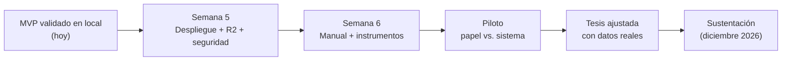

# Trabajo futuro — Taller Digital

| Campo | Valor |
|---|---|
| Para quién | Jurados, docentes y el autor |
| Corte | 05/11/2026 — commit `e51d187` más los ajustes visuales del 05/11/2026 (SPEC §21.11) |
| Base | SPEC §17.2 (después del MVP), §18 (riesgos), §19.2 (criterios para la sustentación), decisión S4-8 |

Este documento separa lo **pendiente** (ya planificado, antes de la sustentación) del **trabajo futuro** (después del proyecto o condicionado al piloto). **Nada de lo descrito aquí está implementado.**

---

## 1. Hoja de ruta

| Bloque | Contenido | Tipo |
|---|---|---|
| Semana 5 | Despliegue en Render + Neon con HTTPS; reportes RF-15 (R2 primero); dashboard completo; seguridad; completar RNF-09 | Pendiente |
| Semana 6 | Manual y guía rápida (RF-21); funciones *Should* si hay tiempo; instrumentos del piloto | Pendiente |
| Semana 7 en adelante | Piloto con datos reales y autorización; medición; ajuste de la tesis | Pendiente |
| Después del proyecto | Escalabilidad, funciones *Could*, integraciones | Trabajo futuro |

---

## 2. Despliegue en Render

**Estado: Pendiente (Semana 5, decisión S4-8).** Requiere que el autor cree una cuenta en Render.

**Qué se hará:**
1. Crear un servicio web en Render conectado al repositorio.
2. **Compilación:** instalar las dependencias del backend con `uv` (incluida fpdf2, que es Python puro y no necesita paquetes del sistema), compilar la interfaz con `npm run build` y aplicar las migraciones (`alembic upgrade head`).
3. **Inicio:** `uvicorn app.main:app --host 0.0.0.0 --port $PORT`. El backend sirve la interfaz compilada desde el mismo dominio (ADR-001), así que no hace falta un segundo servicio ni configurar CORS.
4. **Variables de entorno** en el panel de Render: `DATABASE_URL` (la de Neon), `SECRET_KEY` (nueva, generada solo para producción), `ENTORNO=produccion`.
5. Crear el primer taller real con `crear_taller` y cargar los datos ficticios de demostración en un taller aparte.
6. **Ajustar el límite de consultas por IP del seguimiento:** detrás del proxy de Render, `request.client.host` es la IP del proxy. Hay que tomar la IP real de la cabecera que agrega el proxy, confiando **solo** en ese proxy, para que el límite de 30 consultas por minuto no se aplique a todos los clientes a la vez.

**Riesgos y mitigación:**

| Riesgo | Mitigación |
|---|---|
| El plan gratuito «duerme» el servicio tras un rato sin uso y la primera solicitud tarda varios segundos (R-07) | Abrir el sistema antes de cada sesión del piloto y de la sustentación; no cronometrar ese primer arranque |
| Cambios en las condiciones del plan gratuito | La aplicación no usa funciones propias del proveedor (RNF-10); se puede mover a otro PaaS |
| El límite en memoria cuenta por instancia | Con una sola instancia (plan gratuito) funciona; con varias, pasarlo a un almacén compartido |

---

## 3. Neon (PostgreSQL administrado)

**Estado: Pendiente (Semana 5).** Requiere una cuenta del autor en Neon.

**Qué se hará:**
1. Crear un proyecto PostgreSQL 17 en Neon.
2. Usar la cadena de conexión con SSL obligatorio, con el formato `postgresql+psycopg://…?sslmode=require`.
3. Aplicar las migraciones 0001 a 0007.
4. **Respaldos:** definir y **probar** una restauración. El criterio de la fase de despliegue (F8) exige un respaldo de la base probado. Se recomienda un respaldo semanal con `pg_dump` (R-07).
5. Definir cuánto tiempo se conservan las copias de seguridad, por la Ley 1581: una copia anterior a una anonimización todavía contiene los datos personales.

**Por qué en otro proveedor que la aplicación:** el SPEC §8 separa la aplicación (PaaS) de la base de datos (PostgreSQL administrado) para no depender de un solo proveedor. Si uno cambia sus condiciones, solo se mueve una pieza.

---

## 4. HTTPS

**Estado: Pendiente (llega con el despliegue).** Es parte de RNF-04 y del criterio de éxito de la sustentación (§19.2).

- Render entrega HTTPS con certificado automático en su dominio.
- Con `ENTORNO=produccion`, la cookie de sesión se marca como `Secure` y solo viaja por HTTPS. **Ya está implementado** y se activa con esa variable.
- **Por agregar:** la cabecera HSTS para que el navegador use siempre HTTPS (ver la sección 6).
- Neon exige SSL en la conexión entre la aplicación y la base.

---

## 5. Reportes avanzados

**Estado: Pendiente (Semana 5).** RF-15 es *Must*. Los datos se registran desde la Semana 3, así que **no se ha perdido evidencia**.

| Reporte | Contenido | Fuente | Prioridad |
|---|---|---|---|
| **R2** | Tiempo promedio en cada etapa (incluida «Esperando repuestos»); tiempo total de recepción a entrega; % de órdenes que esperaron repuestos; espera promedio de repuestos | `historial_estado_orden` | **Primera**: es la evidencia de la pregunta de investigación |
| R1 | Órdenes por estado, período y mecánico | `orden_trabajo`, `asignacion_orden` | Segunda |
| R3 | Repuestos más consumidos | `orden_repuesto`, `movimiento_inventario` | Tercera |
| R4 | Repuestos con stock bajo | `repuesto` | Cuarta (ya existe como alerta) |
| Propuesta | Problemas más frecuentes por tipo de vehículo | `orden_trabajo.categoria_problema` (desde la migración 0007) | Sin prioridad asignada: no está en RF-15; requiere aprobación del autor |

Además:
- Pantalla **Reportes** con filtros de período y mecánico (boceto en el SPEC, Anexo A).
- **Dashboard completo** (RF-14), más allá de los conteos actuales.
- *Could*: exportar a CSV (RF-22). La liquidación imprimible (RF-23) ya está **parcialmente** cubierta por el informe PDF de las órdenes entregadas; faltaría imprimir la de una orden abierta, si se aprueba.
- Criterio de éxito: **R2 calcula los tiempos por etapa con datos reales del piloto** (§19.2).

---

## 6. Mejoras de seguridad

**Estado: Pendiente (Semana 5, fase F7).** Criterio: la revisión no deja hallazgos críticos.

| Mejora | Para qué | Estado actual |
|---|---|---|
| Límite de intentos de inicio de sesión | Frenar ataques de fuerza bruta contra las claves | No existe (solo hay límite en el seguimiento público) |
| Cabeceras de seguridad (CSP, HSTS, `X-Content-Type-Options`, `Referrer-Policy`, `frame-ancestors`) | Reducir XSS, clickjacking y degradación a HTTP | No existen |
| Auditoría de dependencias (`pip-audit` / `npm audit`) | Detectar librerías con vulnerabilidades conocidas | No realizada |
| Cambio de clave por el usuario y restablecimiento por el administrador | Hoy no hay forma de cambiar una clave desde la interfaz | No existe |
| IP real detrás del proxy para el límite del seguimiento | Que el límite sea por cliente y no por proxy | Pendiente con el despliegue |
| Auditoría de accesibilidad con Lighthouse o axe | Cumplir RNF-07 con evidencia | Revisión manual hecha; herramienta pendiente. Incluir el contraste del texto sobre los fondos al 50 % (T-3) |
| Revisión de código completa | Fase F7 | Pendiente |
| Registro de inicios de sesión fallidos | Detectar intentos de acceso | Trabajo futuro |

Lo que **ya existe** y no se recorta: argon2id, cookie httpOnly con `SameSite=Lax`, JSON obligatorio en las modificaciones, permisos verificados en cada solicitud, filtro por taller, validación de la entrada y consultas parametrizadas.

---

## 7. Piloto real

**Estado: Pendiente (Semana 7 en adelante).** Es la parte del objetivo específico OE3 que falta: **evaluar con una prueba piloto**.

**Diseño previsto (SPEC §17.2, §19.2, riesgos R-02, R-08, R-12):**

1. **Talleres:** mínimo **3** (2 formales y 1 informal). Los 10 de la tesis no son viables para una sola persona (R-12).
2. **Línea base:** **cronometrar el proceso en papel antes de usar el sistema** (R-02). Sin esa medición no hay contra qué comparar.
3. **Autorización:** datos reales solo con la autorización de cada taller y de sus clientes (H-5, Ley 1581).
4. **Capacitación** presencial con el [Manual de usuario](01-manual-usuario.md) y una guía rápida (RF-21).
5. **Uso del sistema** en la operación diaria durante el período acordado.
6. **Medición:** reporte R2 (tiempos por etapa y total), RNF-02 (abrir una orden en menos de 2 minutos) y un cuestionario de usabilidad.
7. **Ajuste de la tesis:** reescribir los capítulos 4 y 7 con los datos reales (H-3) y corregir las inconsistencias del Anexo B del SPEC.

**Riesgos:** rechazo de los talleres informales (R-08), conexión débil en el taller (R-09) y arranque lento del plan gratuito (R-07).

---

## 8. Escalabilidad

**Estado: Trabajo futuro.** El MVP está dimensionado para un piloto: decenas de usuarios y miles de órdenes (SPEC §2.3).

| Si el sistema crece a… | Cambio necesario |
|---|---|
| Más tráfico en una instancia | Plan de pago con más memoria y sin suspensión; varios procesos de Uvicorn |
| Varias instancias de la aplicación | Llevar el limitador de solicitudes de memoria a un almacén compartido (por ejemplo, Redis) |
| Muchos talleres con mucho volumen | Revisar índices con datos reales y medir RNF-03 (listados en menos de 2 s con 5.000 órdenes por taller) |
| Aislamiento más fuerte entre talleres | Evaluar Row-Level Security de PostgreSQL como segunda barrera del filtro por `taller_id` |
| Talleres que quieren gestionarse solos | Pantalla de superadministración y de datos del taller (hoy se crean por script) |
| Notificaciones | Botón de WhatsApp sin API (RF-20) y, más adelante, una integración con costo |
| Más funciones del negocio | Catálogo de servicios (RF-18), historial en el enlace del cliente (RF-19), citas (RF-26), recordatorios (RF-25) |
| Catálogo de categorías editable por taller | Hoy es fijo en el código (O-5); habría que llevarlo a una tabla por taller, conservando el nombre guardado en cada orden |
| Informe PDF con tipografía completa | Incrustar una fuente Unicode en fpdf2 para no reemplazar emoji ni comillas tipográficas (O-4) |

**Lo que no cambia al escalar:** la API, el modelo de datos y el aislamiento por taller ya están pensados para varios talleres en una sola instalación (ADR-006).

---

## 9. Criterios de éxito para la sustentación (SPEC §19.2)

| Criterio | Estado al 05/11/2026 |
|---|---|
| 1. Todos los *Must* (RF-01 a RF-17) funcionan en la URL pública con HTTPS | 15 implementados, RF-14 parcial, RF-15 pendiente; sin URL pública |
| 2. `pytest` pasa y cubre RN-01 a RN-21, las transiciones y el aislamiento | 263 pruebas pasan; cobertura del backend 91 %; falta formalizar la trazabilidad regla por regla (RNF-09) |
| 3. Una orden recorre el ciclo completo desde un celular de 360 px y el cliente la ve en su enlace | Cumplido en local |
| 4. R2 calcula los tiempos por etapa con datos reales del piloto | Pendiente |
| 5. La revisión de seguridad no deja hallazgos críticos | Pendiente |
| 6. El piloto produce datos de tiempo y usabilidad en al menos 3 talleres | Pendiente |
| 7. La infraestructura cuesta $0 | Cumplido en local; por confirmar en la nube |
