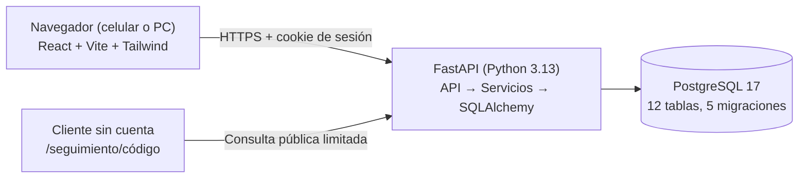

# Resumen ejecutivo de sustentación — Taller Digital

| Campo | Valor |
|---|---|
| Proyecto | Prototipo web para la gestión de los procesos operativos en talleres mecánicos de la zona norte de Cali |
| Autor | John Edison Hernández Vargas — Ingeniería de Software, Corporación Universitaria Iberoamericana |
| Corte | 28/10/2026 — commit `84f20f3` |
| Carácter | Anexo de sustentación. Resume la documentación extensa de esta carpeta |

---

## 1. Resumen general del proyecto

**Nombre.** *Taller Digital*: prototipo web (MVP) de gestión operativa para talleres mecánicos pequeños y medianos, formales e informales, de las comunas 2, 4, 5 y 6 de Santiago de Cali.

**Contexto.** En la zona norte de Cali hay alta densidad vehicular y un parque automotor envejecido, con una demanda constante de mantenimiento. Aun así, la mayoría de los talleres opera con cuadernos, hojas sueltas y mensajes de WhatsApp. Según la fuente citada en la investigación, solo cerca del 9 % de los talleres del país usa software especializado.

**Problema identificado.** El diagnóstico (entrevistas y observación en 10 talleres y una encuesta a 384 clientes) encontró:
- cuellos de botella al recibir los vehículos;
- pérdida de información entre recepción y el mecánico;
- inventario contado a mano y sin alertas;
- historial de mantenimiento disperso;
- cobros poco transparentes para el cliente.

El 85 % de los clientes encuestados quiere un canal digital para seguir el estado de su vehículo, y el 78 % percibe demoras e informalidad en los registros en papel.

**Justificación.** Digitalizar el ciclo de servicio permite organizar la operación y dar transparencia al cliente. Sobre todo, permite **medir objetivamente los tiempos de cada etapa**, que es la evidencia que requiere la pregunta de investigación: ¿qué impacto tendría un prototipo web en la reducción de los tiempos de respuesta y en la eficiencia de los procesos operativos?

**Objetivo general.** Desarrollar un prototipo web para la gestión de los procesos operativos en talleres mecánicos de la zona norte de Cali.

---

## 2. Solución desarrollada

**Qué hace.** Acompaña a cada vehículo desde que entra al taller hasta que se entrega, y le da al cliente un enlace para seguirlo desde su celular sin crear una cuenta.

**Cómo funciona.**

```
Cliente → Vehículo → Orden de trabajo → Mecánico → Estados → Repuestos e inventario → Liquidación → Entrega
                                                     ↘ Enlace de seguimiento para el cliente
```

1. Recepción registra al cliente, con su autorización de datos, y su vehículo.
2. Abre una orden de trabajo a partir de la placa y asigna un mecánico.
3. El mecánico registra el diagnóstico, la mano de obra y los repuestos, y avanza los estados.
4. Cada repuesto usado se descuenta del inventario y el sistema calcula el cobro.
5. Recepción entrega el vehículo; el cliente ve todo el proceso desde su enlace.

**Procesos que digitaliza:** recepción de vehículos, asignación del trabajo, seguimiento del servicio, control de inventario, liquidación, historial de mantenimiento, comunicación con el cliente y tratamiento de datos personales.

**Módulos:** acceso y usuarios · clientes · vehículos · órdenes y estados · asignación de mecánicos · inventario · repuestos y mano de obra en la orden · liquidación · seguimiento público · inicio (dashboard mínimo) · anonimización.

---

## 3. Arquitectura implementada

Es un **monolito cliente-servidor por capas** con API REST. Se eligió por tratarse de un solo desarrollador, sin presupuesto y con el volumen de un piloto. Está documentado en 6 registros de decisiones de arquitectura (ADR).



| Componente | Implementación |
|---|---|
| **Frontend** | React con React Router, Vite y Tailwind CSS. Diseñado primero para el celular (desde 360 px), con el vocabulario del taller. El servidor lo entrega desde el mismo dominio |
| **Backend** | FastAPI organizado en API (validación y permisos), servicios (reglas de negocio) y acceso a datos (SQLAlchemy 2). 35 operaciones de API documentadas automáticamente |
| **Base de datos** | PostgreSQL 17 con migraciones Alembic. Las reglas críticas se garantizan también en la base: restricciones CHECK, índices únicos parciales y relaciones que impiden borrar la historia |
| **Autenticación** | Claves con hash argon2id; sesión con un token firmado en una cookie `httpOnly`; el usuario y su rol se vuelven a leer de la base en cada solicitud; mensaje genérico ante credenciales inválidas |
| **Multi-taller** | Una sola instalación para varios talleres. Cada registro pertenece a un taller, que se toma siempre del usuario de la sesión. Un recurso de otro taller responde «no encontrado» |
| **Seguimiento público** | Enlace por orden con un código aleatorio de 128 bits. Muestra el estado, la línea de tiempo y el cobro, con la placa enmascarada y **sin datos personales**. Admite 30 consultas por minuto por IP |

---

## 4. Funcionalidades implementadas

| Funcionalidad | Qué permite | Estado |
|---|---|---|
| Usuarios y roles | Tres roles (Administrador, Recepción, Mecánico); crear, cambiar el rol, activar y desactivar | **Completa** (sin cambio de clave) |
| Clientes | Registro con autorización obligatoria (Ley 1581), búsqueda, edición y desactivación | **Completa** |
| Vehículos | Placa normalizada y única por taller, cambio de dueño, historial de mantenimiento | **Completa** |
| Órdenes | Recepción desde la placa, consecutivo por taller, una sola orden abierta por vehículo | **Completa** |
| Estados | Seis estados con historial (usuario, fecha y nota), cancelación con motivo, retroceso solo para el administrador | **Completa** |
| Asignación de mecánicos | Asignar y reasignar con historial; vista «Mis órdenes»; carga por mecánico | **Completa** |
| Inventario | Catálogo, entradas, ajustes por conteo físico, movimientos y alertas de stock | **Completa** |
| Repuestos en la orden | Descuento automático del stock, devolución al quitar o cancelar, precio congelado | **Completa** |
| Liquidación | Mano de obra + repuestos = total, calculado por el servidor, sin IVA | **Completa** |
| Seguimiento público | Enlace sin cuenta, sin datos personales | **Completa** (falta publicarlo en internet) |
| Dashboard | Órdenes por estado, entregados hoy y alertas de stock | **Parcial** (versión mínima aprobada) |
| Anonimización | Borrado de datos personales conservando la historia, solo administrador, confirmación escrita y auditoría | **Completa** |

---

## 5. Resultados alcanzados

| Resultado | Valor |
|---|---|
| Pruebas automatizadas | **214**, todas pasan, ejecutadas contra PostgreSQL real |
| Pruebas de concurrencia | 3: número de orden, orden abierta única y stock nunca negativo |
| Pruebas de aislamiento entre talleres | En cada recurso del sistema |
| Requisitos obligatorios (*Must*) | 15 de 17 completos, 1 parcial, 1 pendiente |
| Reglas de negocio | 21 de 21 implementadas |
| Validación de punta a punta (Semana 4) | 32 de 32 verificaciones correctas |
| Calidad estática | Ruff (Python) y ESLint (JavaScript) sin hallazgos |

**Validaciones manuales.** El autor validó cada entrega semanal con su demostración y su criterio de cierre: inicio de sesión y permisos; clientes y vehículos; órdenes y estados; y el flujo completo. También validó la anonimización en 11 puntos, entre ellos la restricción por rol, la conservación de órdenes y vehículos, el seguimiento después de anonimizar, el bloqueo con órdenes abiertas y la visualización en celular. Cada pantalla se revisó en cuatro anchos (360, 768, 1024 y 1440 px), con teclado y en los estados vacío, de error y de carga.

**Evidencia de funcionamiento del MVP.** El flujo completo funciona de punta a punta en el entorno local: cliente → vehículo → orden → asignación → estados → inventario → liquidación → entrega → seguimiento del cliente → anonimización. Se usaron únicamente datos ficticios. El [guion de demostración](05-guion-demostracion.md) lo reproduce en vivo en 14 minutos.

---

## 6. Beneficios del sistema

| Beneficio | Cómo se logra |
|---|---|
| **Organización del taller** | Cada vehículo tiene una orden con estado, responsable y fecha estimada; el inicio muestra cuántas órdenes hay en cada etapa |
| **Trazabilidad** | Cada cambio de estado, asignación, repuesto y movimiento de inventario queda con fecha, hora y usuario; las órdenes y los movimientos nunca se borran |
| **Control de inventario** | Descuento automático por orden, stock que nunca queda negativo, alertas de reposición y ajustes con motivo obligatorio |
| **Seguimiento al cliente** | Enlace por orden para ver el estado y el cobro desde el celular, sin cuenta y sin llamar al taller |
| **Protección de datos** | Autorización obligatoria con fecha, datos mínimos, enlace público sin datos personales y anonimización auditada (Ley 1581 de 2012) |
| **Separación entre talleres** | Varios talleres en una instalación, cada uno con acceso exclusivo a sus datos, comprobado con pruebas automatizadas |

---

## 7. Estado actual del proyecto

**IMPLEMENTADO** (MVP terminado y validado en entorno local):
- Inicio y cierre de sesión, tres roles y gestión de usuarios.
- Clientes con autorización de datos; vehículos con historial de mantenimiento.
- Órdenes de trabajo con seis estados, historial y asignación de mecánicos.
- Inventario con entradas, ajustes, movimientos y alertas.
- Repuestos y mano de obra en la orden; liquidación sin IVA.
- Seguimiento público por enlace, sin datos personales.
- Dashboard mínimo.
- Anonimización de clientes con auditoría.
- Aislamiento entre talleres y 214 pruebas automatizadas.

**PENDIENTE** (planificado antes de la sustentación):
- Despliegue en Render (aplicación) y Neon (base de datos) con HTTPS.
- Reportes de gestión, empezando por el **tiempo promedio por etapa** (evidencia de la investigación).
- Dashboard completo.
- Refuerzo de seguridad: límite de intentos de inicio de sesión, cabeceras de seguridad, auditoría de dependencias, cambio y recuperación de clave.
- Guía rápida de usuario y cobertura documentada de pruebas por regla de negocio.
- **Prueba piloto** en al menos 3 talleres, con medición previa del proceso en papel y un cuestionario de usabilidad.

**TRABAJO FUTURO** (fuera del alcance actual):
- Catálogo de servicios, botón de WhatsApp e historial del vehículo en el enlace del cliente.
- Exportación a CSV, liquidación imprimible, citas y recordatorios de mantenimiento.
- Escalamiento a varias instancias y una pantalla de administración de talleres.
- Facturación electrónica DIAN, pagos en línea y notificaciones automáticas (excluidas del prototipo).

---

## 8. Conclusiones

1. **Se cumplió el objetivo general en su alcance de producto mínimo viable.** Se desarrolló un prototipo web funcional que cubre el ciclo operativo completo de un taller mecánico, desde la recepción del vehículo hasta su entrega, y que incorpora al cliente mediante un canal digital de seguimiento.

2. **La especificación previa al código y el registro de decisiones dieron trazabilidad y control del alcance.** Cada requisito remite a su fuente en la investigación y cada decisión quedó documentada. Esto permitió priorizar con el método MoSCoW, entregar por incrementos semanales verificables y justificar técnicamente cada elección.

3. **La integridad de la información se garantizó en dos niveles complementarios.** Las reglas críticas del negocio se aplican en la lógica de la aplicación y también en el motor de base de datos, y su comportamiento ante operaciones simultáneas se verificó con pruebas automatizadas.

4. **La protección de datos personales se incorporó desde el diseño.** La autorización obligatoria, la minimización de datos, la exclusión de información personal en el canal público y la anonimización auditada demuestran que es posible cumplir la Ley 1581 de 2012 sin sacrificar la historia operativa del taller.

5. **La arquitectura multi-taller demuestra la viabilidad técnica de una sola instalación compartida.** Varios talleres pueden operar en la misma infraestructura con sus datos aislados, lo que favorece un modelo de bajo costo acorde con la realidad económica del sector.

6. **El sistema constituye un instrumento de medición para la investigación.** Al registrar cada evento con fecha, hora y responsable, convierte la operación del taller en datos objetivos. Con ellos, la prueba piloto podrá responder la pregunta de investigación con evidencia cuantitativa y no con percepciones.

7. **El alcance pendiente está identificado y planificado.** El despliegue, los reportes de tiempos y la prueba piloto son los pasos necesarios para pasar de la validación técnica a la evaluación del impacto en campo.

---

## 9. Mensaje final para los jurados

**Qué se construyó.** Taller Digital, un prototipo web funcional para talleres mecánicos de la zona norte de Cali. Digitaliza la recepción de vehículos, las órdenes de trabajo con sus estados, la asignación de mecánicos, el inventario de repuestos, la liquidación y el seguimiento del cliente, e incorpora la protección de datos personales exigida por la ley colombiana. Lo sustentan una especificación formal, seis decisiones de arquitectura documentadas y una base de datos de doce tablas con sus reglas de integridad.

**Qué se validó.** El flujo operativo completo funciona de punta a punta en el entorno local, con datos ficticios. Lo respaldan 214 pruebas automatizadas que pasan contra PostgreSQL real, entre ellas pruebas de concurrencia y de aislamiento entre talleres, y las validaciones funcionales del autor al cierre de cada entrega, incluida una verificación integral de 32 puntos y la validación de la anonimización.

**Qué valor aporta.** Al taller le da organización, trazabilidad de cada acción, control confiable del inventario y cobros transparentes. Al cliente le da información oportuna sobre su vehículo sin exponer sus datos. A la investigación le aporta un instrumento que registra los tiempos de cada etapa del servicio, la base para medir el impacto planteado en la pregunta de investigación.

**Por qué el proyecto se considera exitoso en su etapa actual.** Porque cumple el objetivo general con un producto funcional, probado y documentado. Implementa la totalidad de las reglas de negocio y quince de los diecisiete requisitos obligatorios, aplica prácticas de ingeniería verificables y respeta el marco legal de protección de datos. Además, distingue con claridad lo logrado de lo pendiente: el despliegue público, los reportes de tiempos y la prueba piloto. Estos últimos son el camino definido para evaluar en campo el impacto que el sistema ya está preparado para medir.
